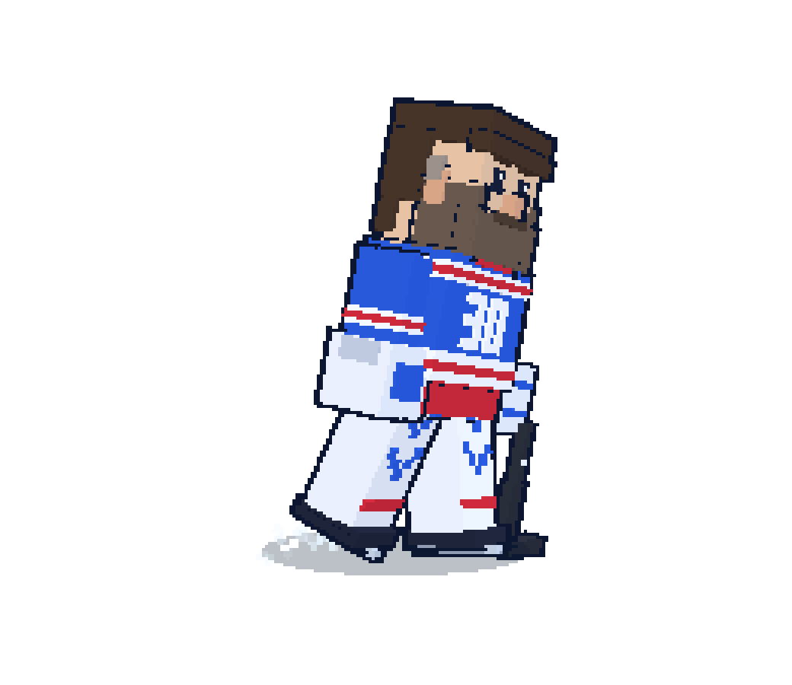

<p align="center"></p>

<h1 align="center">Henrik</h1>

<p align="center">A calm, well-groomed goalie who glides around your desktop and types what you say.<br>A fork of <a href="https://github.com/Pyanov/frog">Pyanov/frog</a>, an open-source, on-device alternative to Wispr Flow and Granola for the Mac, with swappable avatars.</p>

Hold **fn** and talk. Henrik types what you say into whatever is in front of you: a Claude Code or Codex prompt, a terminal, an email. Let go and the text is there. Start him before a call and he takes the notes: who said what, and a summary to read afterwards. Hold **right ⌥ Option** and talk to him. He answers out loud, remembers what you tell him, and keeps you company while he skates laps around your screen.

Everything runs on your Mac. Speech recognition, speaker labels, and Henrik's brain are local models, downloaded once. Nothing you say leaves the machine.

## In his own words

> I keep the net on your desktop. You hold a key and talk, I type it. Clean save. I take your meeting notes while you look out the window. I remember what you tell me and remind you when it's time. In between, I skate. Please don't touch the hair.

## What it does

- **Dictation anywhere.** Hold fn, speak, release. The text lands where your cursor is. Made for coding agents: a long prompt is faster to say than to type.
- **Meeting notes.** Right-click Henrik → Notes → Start before a call. He records you and the other side, transcribes both, labels the speakers, and writes a summary.
- **A goalie to talk to.** Hold right Option and say something. He talks back, remembers facts ("my sister's name is Anna"), and sets reminders ("remind me at four to call the dentist"), which he says aloud when due. The Mind tab shows what he knows.
- **Words.** Teach him names and jargon. He suggests words he keeps hearing, and correcting a dictation teaches him.
- **He glides.** Henrik skates around the screen with momentum: he pushes off, carves wide turns, coasts to a stop, bounces off the screen edges like a puck off the boards, leans into turns and kicks up ice spray. Switch that off in Me, or in the menu bar, if it bugs you.
- A small hockey stick in the menu bar hides or shows him, opens Notes and settings, and quits.

| State | What Henrik does |
|---|---|
| Listening | Rings pulse with your voice, he stretches with the loudness |
| Thinking | Juggles a puck, thought dots overhead |
| Done | Jumps, confetti, **SAVE!** and a goal horn |
| Notes | Recording light over his shoulder |
| Confused / sleeping | A wobbling "?", or drifting z's |

## Avatars: Henrik (default) or the frog

The pet is swappable. Each avatar is a folder in `web/src/avatars/`, and `web/avatar.config.js` picks the one that ships:

```js
export default {
  avatar: 'henrik',   // or 'frog'
}
```

Or override at build time without editing anything:

```bash
AVATAR=frog ./build.sh
```

To use your own picture, copy `web/src/avatars/henrik/`, drop in a transparent PNG or SVG (character facing right, feet at the bottom edge), and point `avatar.config.js` at the new folder. The shared sprite engine (`web/src/sprite-pet.js`) animates any image: breathing, gliding, every state. The avatar's name also picks its personality and voice lines. Details in [`web/src/avatars/README.md`](web/src/avatars/README.md).

## The models

All on device, downloaded on first use.

| Job | Model |
|---|---|
| Speech to text | Apple's on-device speech model (SpeechAnalyzer). On Apple Silicon, NVIDIA Parakeet TDT v3 (Core ML, via FluidAudio) is also an option in Me. |
| Who said what | FluidAudio speaker diarization (Core ML, Apple Silicon only). |
| Henrik's brain | Gemma 4 through llama.cpp, picked by RAM: E4B (5 GB) on 16 GB Macs, 12B (7 GB) on 24 GB, 26B-A4B (17 GB) on 40 GB and up. Qwen2.5 1.5B (1 GB) is the tiny option. |
| Meeting summaries | Apple Intelligence's on-device model. Add a Claude API key in Me and it uses Claude instead; that is the one optional thing that leaves your Mac. |
| Voice | macOS "Grandpa" (AVSpeechSynthesizer). Pick another in Me. |

## Install a prebuilt Intel (amd64) app

1. Open the repo's **Actions** tab → latest **Build macOS app (amd64)** run → download the `VoicePet-amd64` artifact, unzip it twice, drag `VoicePet.app` to Applications.
2. First launch: macOS will say it's from an unidentified developer. Open System Settings › Privacy & Security, scroll down, click **Open Anyway**. Once.
3. Grant Microphone, Speech Recognition, and Accessibility when asked (Accessibility is for the fn key and for typing into other apps).
4. System Settings › Keyboard › "Press 🌐 key to" → **Do Nothing**, or fn also opens the emoji picker.

Needs macOS 26. On first launch it downloads its brain in the background. Dictation works immediately; Henrik starts talking once the download is done.

## Build from source

```bash
git clone https://github.com/DrewHengehold/spriteHelper.git && cd spriteHelper
(cd web && npm ci)
./build.sh                  # native architecture
ARCH=amd64 ./build.sh       # Intel x86_64, also cross-compiles from Apple Silicon
mkdir -p ~/Applications
ditto build/VoicePet.app ~/Applications/VoicePet.app
open ~/Applications/VoicePet.app
```

`lipo -archs build/VoicePet.app/Contents/MacOS/VoicePet` shows what you built. Building requires macOS 26, Xcode Command Line Tools, and Node 20.19+ or 22.12+; full Xcode is not required. The first build compiles llama.cpp and can take several minutes.

Apple Silicon provides every feature. An Intel (amd64) build uses Apple Speech and omits Parakeet transcription and FluidAudio speaker diarization. CI (`.github/workflows/build-amd64.yml`) runs the web tests and builds the amd64 app on every push to `main` or `henrik`.

Web checks while developing an avatar:

```bash
cd web
npm test              # unit tests, including the avatar config checks
npm run build
npm run capture       # renders every state to web/shots/*.png
```

`npm run capture` uses an installed Chrome, Edge, Brave, or Chromium browser when available. If none is installed, install Playwright's Chromium once with `npm run playwright:install`. In a browser, `?avatar=frog`, `?demo=1` (cycle states), `?glide=1` (fake skating) and `?bg=1` help with previews.

## Under the hood

Swift/AppKit app built with SwiftPM. Apple SpeechAnalyzer or Parakeet v3 for speech, FluidAudio for diarization, llama.cpp via LLM.swift for the brain (Gemma 4 GGUFs from Unsloth), Apple Foundation Models for summaries, AVSpeechSynthesizer for the voice, a WKWebView for the pet (a 2D canvas sprite for Henrik, three.js for the frog). `Wander.swift` moves the window: `glide` for Henrik, `walk` for the frog, picked by the avatar's `pet.motion`. Notes, vocabulary, memory, and models live in `~/Library/Application Support/VoicePet/`.

## Credits and license

Based on [Frog](https://github.com/Pyanov/frog) by Pyanov and contributors. MIT.
